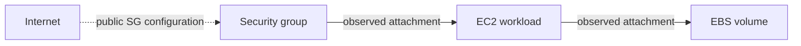

# Exposure and dependency explorer

Open **Exposure model**, search for a resource and select it. The inspector shows
its observed public configuration, evidence and collection limitations. Select
**Explore connections** to choose incoming, outgoing or both directions and up
to four hops. Select a connection to inspect why it exists. Candidate Internet
paths can be highlighted. Zoom, pan and an accessible keyboard node list help
explore the same model; a 390px layout supports the browser on phones.

The Query explorer uses this renderer for the exact relationships its query
matched. An aggregate query returns a table rather than inventing graph edges.
**All results** restores the original bounded graph after exploring context.

## What the arrows mean

| Relationship | Direction | Confidence / evidence |
| --- | --- | --- |
| `PUBLIC_CONFIGURATION` | Internet → resource | Candidate; public address, unrestricted endpoint, public SG CIDR, or S3 public-policy classification/effective safeguards |
| `SECURITY_GROUP_ATTACHED` | SG → EC2/RDS/EKS resource | Observed group identifier on the workload's metadata |
| `ALLOWS_GROUP` | Referenced SG → SG with ingress rule | Observed ingress group reference; does not establish transitive access |
| `USES_VOLUME` | EC2 instance → EBS volume | Observed instance ID in the volume's attachment metadata |
| `LOGS_TO` | CloudTrail account summary → S3 bucket | Observed configured S3 destination; delivery is unverified |
| `DEPLOYS_TO` | Repository → resource | Declared; exact `repository` or `source-repo` tag association, not verified deployment provenance |
| `HAS_FINDING` | Resource → finding | Recorded finding, with status and its own last-observed time |
| `CONTAINS` | Connection → resource | Source membership; available to queries, excluded from impact neighborhoods |
| `REPORTED` | Connection → finding | Source membership; available to queries, excluded from impact neighborhoods |

Solid lines show observed configuration, dashed amber lines candidate exposure,
and dotted purple lines declared associations. Confidence describes the evidence
for the relationship, not the probability of exploitation. Finding counts shown
on nodes count open findings admitted to this bounded graph.

## Example: a public bucket

A potential S3 public-policy configuration connects Internet to the bucket. The
inspector displays `policy_public` and the effective account/bucket Block Public
Access values. `RestrictPublicBuckets=true` suppresses this policy candidate;
`BlockPublicPolicy=true` alone does not establish that an existing public policy
is restricted. AWS explains [effective Block Public Access](https://docs.aws.amazon.com/AmazonS3/latest/userguide/configuring-block-public-access-bucket.html)
and the [individual settings](https://docs.aws.amazon.com/AmazonS3/latest/userguide/access-control-block-public-access.html).

A collected CloudTrail destination adds a separate `LOGS_TO` edge to that same
bucket. It highlights a service whose configured logging depends on the bucket,
so an operator can investigate the effect of bucket changes. This does **not**
prove that the service can be compromised through the bucket. Bucket object ACLs,
access points, organization-policy collection, anonymous object reads and actual
log delivery are not independently tested. The collector never reads S3 objects.

## Example: public configuration to a workload and its data volume

The chain explains which observed resources share configuration dependencies.
Network routes, NACLs, listeners, egress, WAF, effective IAM permissions, software
vulnerabilities and exploitability are unverified. A public IP alone is not proof
of access. A private-IP workload attached to a permissive SG is not automatically
Internet reachable. Reverse dependency exploration is context, not a claim that
an exploit travels along every arrow.

## Bounds and missing evidence

The graph reads latest snapshots, not live AWS. Cross-source code associations
require explicit tags; AWS identifiers are resolved within the same connection
and region where applicable. Uncollected/failed scopes are visible in coverage.
A missing path or `not_observed` condition does not establish privacy or isolation.
A new scan refreshes metadata; old findings retain their evidence and timestamp.

The resource API graph admits 1,000 resources. Neighborhoods admit 150 nodes and
300 edges; the diagram displays up to 100 nodes and 200 connections with an
explicit notice. Filter to narrow larger results. Candidate Internet paths are
limited to four hops, 20 paths and 10,000 search operations, independent of the
neighborhood direction. Byte limits can further reduce returned nodes/edges.
All truncation is explicit. Graphs, queries and saved libraries are workspace
scoped; existing roles and API-key boundaries apply.

These additions reuse existing AWS responses: volume attachments, SG references,
EKS group IDs and CloudTrail destinations. No new provider APIs, snapshots, image
pulls, agents or graph database are required. Route tables, full IAM reachability,
additional service dependencies and verified deployment lineage remain roadmap
work. This preview does not claim Wiz feature parity.
